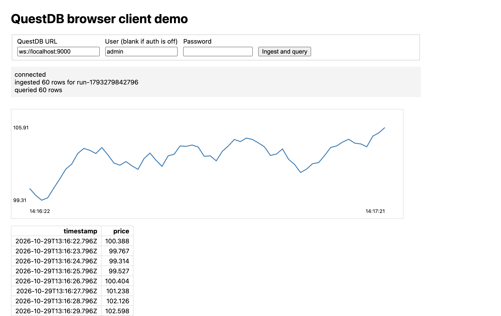
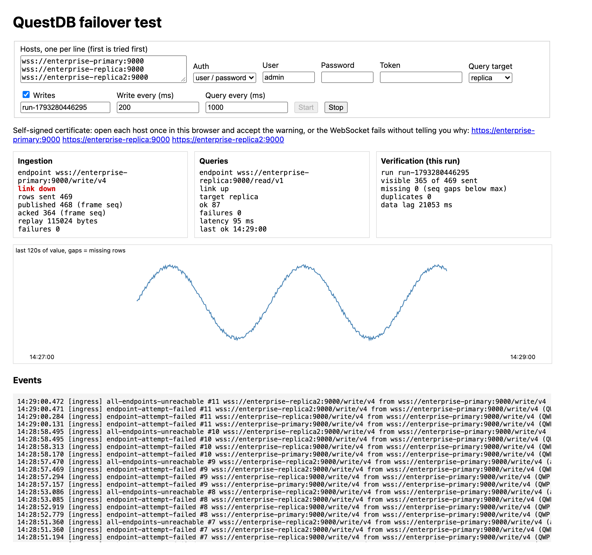
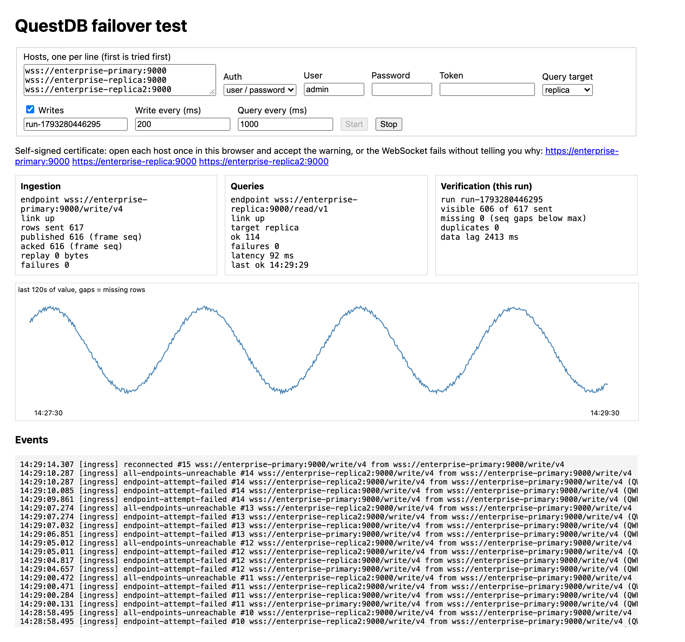

# QuestDB JavaScript client examples

Examples for `@questdb/browser-client` and `@questdb/nodejs-client` 5.0.0, written
from the QuestDB documentation. Both failover tests write to and read from the same
`browser_failover` table, so either one can verify a run made by the other.

## Browser (`browser/`)

- `index.html`: ingests 60 rows, queries them back, and shows a table and a chart.
- `failover.html`: continuous writes and queries against a multi-host cluster, with
  connection events, sequence-gap and duplicate checks, and a read-only mode.



`failover.html` against a three-node QuestDB Enterprise cluster, with queries
routed to a replica. While it ran, the primary was demoted with
`SWITCH ROLE TO REPLICA`, leaving no node that accepts writes, and promoted back
30 seconds later with `SWITCH ROLE TO PRIMARY`.

During the outage, the writer's link is down, every host refuses writes, rows
queue in memory (469 sent, 364 acknowledged), and queries keep running on the
replica:



After the promotion, the writer reconnects and replays the queued rows with
their original timestamps: 617 sent, 0 missing, 0 duplicates, and no gap in
the chart:



The pages load the client from jsDelivr, so there is no build step. Serve them on
the origin that QuestDB allows:

```bash
python3 -m http.server 5173 --bind localhost --directory browser
```

Then open http://localhost:5173/ or http://localhost:5173/failover.html.

On every QuestDB node, allow that origin and reload the configuration with
`SELECT reload_config();`:

```ini
qwp.browser.allowed.origins=http://localhost:5173
```

The browser sends `Origin: http://localhost:5173` wherever QuestDB runs, so this
works for remote servers too. With a self-signed certificate, open each
`https://host:9000` once in the same browser and accept the warning first.

## Node.js (`nodejs/`)

`failover.mjs` runs the same failover test from the command line.

```bash
cd nodejs
npm install
QDB_CLIENT_CONF='wss::addr=host1:9000,host2:9000,host3:9000;username=<user>;password=<password>;tls_verify=unsafe_off;' \
  node failover.mjs
```

- Credentials: `username` and `password`, or `token=<REST token>`.
- TLS: `tls_roots=/path/ca.pem` verifies a self-signed certificate.
  `tls_verify=unsafe_off` skips verification, for testing only.
- `target=replica;` sends queries to replicas.
- Environment: `WRITES=0` for read-only, `RUN_ID`, `WRITE_MS` (200), `QUERY_MS`
  (1000), and `DURATION_S` to stop on its own.
- Ctrl-C waits for every row to be acknowledged, then exits.
